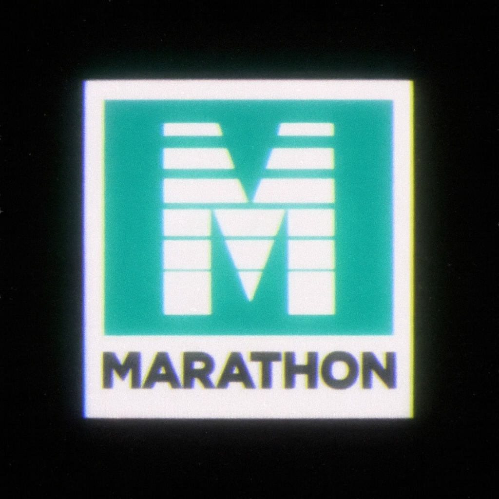
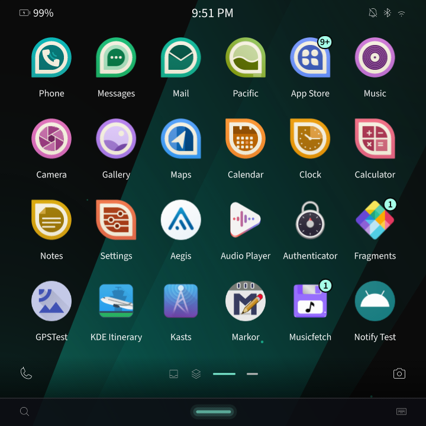
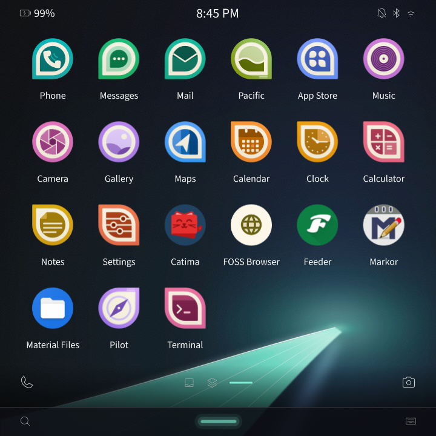
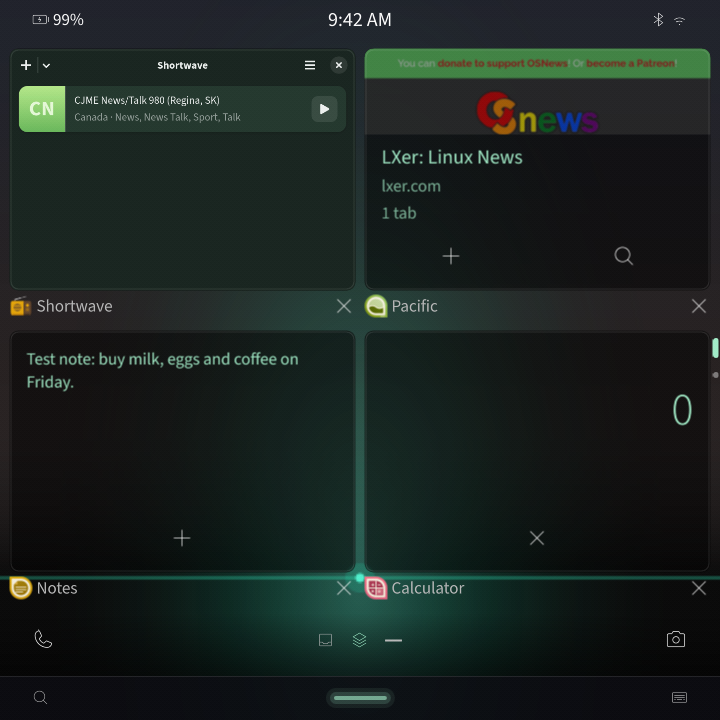
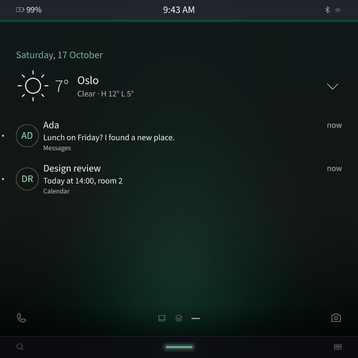
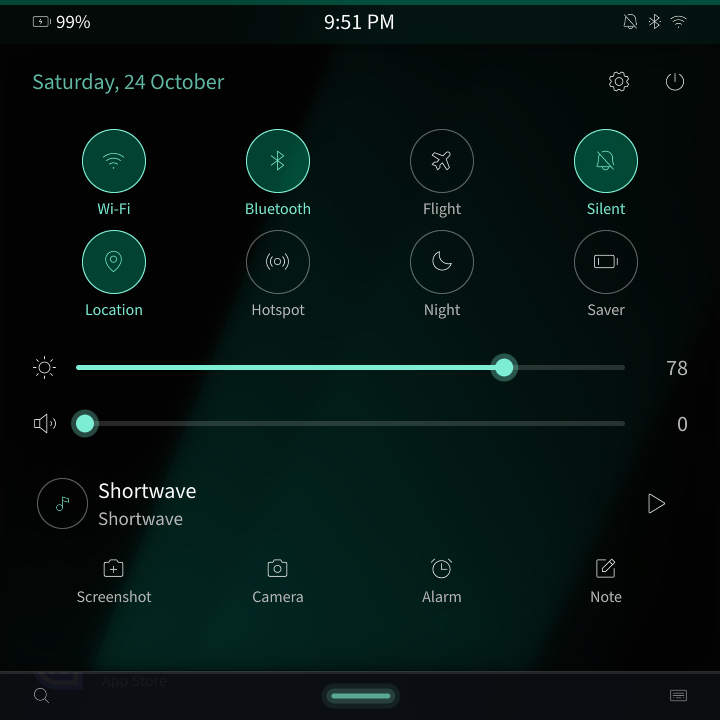
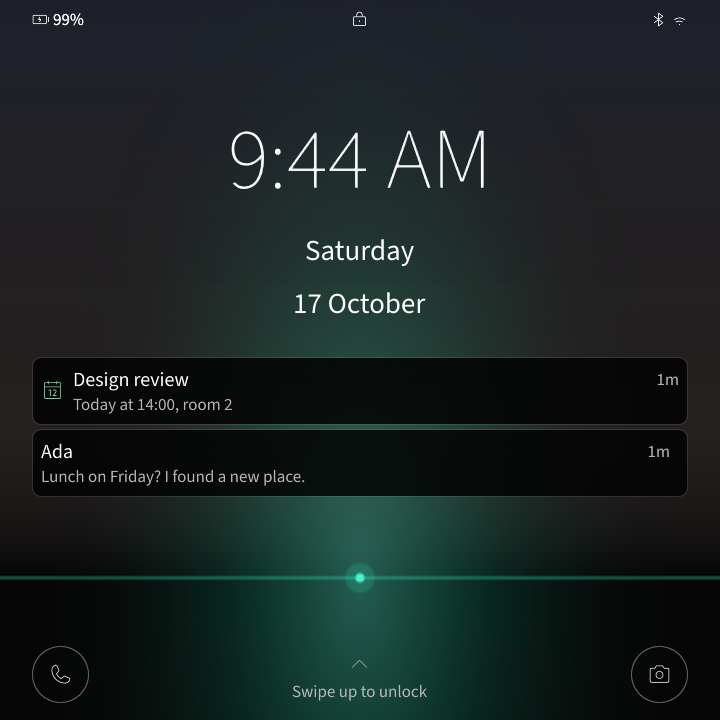
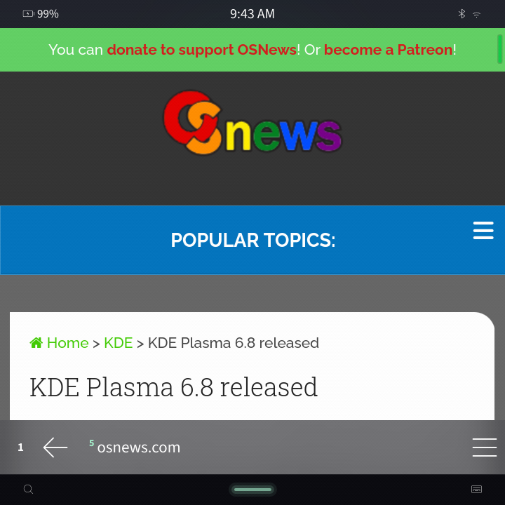
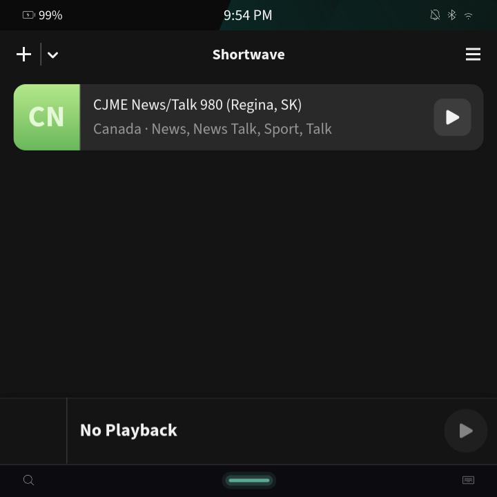
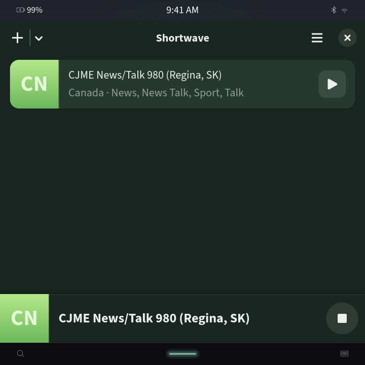

<div align="center">
  

  # Marathon Shell

  **A Wayland compositor and mobile shell for Linux phones**

  [Watch Demo Video](github-media/Screencast%20From%202025-11-09%2004-01-02.mp4)
</div>

---

Marathon Shell is the compositor, shell and app platform of Marathon OS, a
touch-first Linux phone OS built on postmarketOS. One Qt 6 process is both
the Wayland compositor and the shell UI. Marathon's own apps are written
against Keel (Sailfish Silica for Qt 6); native GTK, libadwaita and KDE apps,
usually Flatpaks, run beside them and follow the same theme, scale and
gestures. The repository also holds the Rust services and the image
pipeline under `packaging/`.

## Gallery

| | |
|:---:|:---:|
|  |  |
|  |  |
|  |  |
|  |  |
|  | |

## Architecture

| Part | Where | What it is |
|---|---|---|
| Compositor and shell | `shell/` | Qt 6 (QtWaylandCompositor) compositor and the QML shell UI in one process. Owns the gestures, Hub, task switcher, lock screen, quick settings, keyboard and the shell's D-Bus services (`org.marathonos.Shell`). |
| UI framework | `marathon-silica/`, `packaging/packages/keel-silica` | Keel, Shipwright's Sailfish Silica for Qt 6, used unmodified, plus `Marathon.Silica`: accessibility, keyboard operation and the components Silica lacks. The shell and every bundled app use it. |
| App runner | `tools/marathon-app-runner/` | `marathon-app-runner` and `marathon-keel-host` run each app in its own process and bubblewrap sandbox, with `Marathon.Platform` exposing the shell's services. |
| App platform | `marathon-core/`, `tools/marathon-dev/` | `.marathon` packages: packaging, minisign signing, verification, install, discovery. |
| Data services | `marathon-services/` | Telephony, SMS/MMS, contacts, call history, CalDAV/CardDAV sync, media library, mail (QMF). |
| Rust services | `crates/`, `tools/marathon-mail-oauth/` | `marathon-weatherd`, `marathon-store-handler`, `marathon-core-native`, `marathon-mail-oauth`. |
| Image pipeline | `packaging/`, `scripts/build-image.sh` | Alpine/postmarketOS aports and the duranium/mkosi pipeline that builds device images. |

See [docs/ARCHITECTURE.md](docs/ARCHITECTURE.md) for more.

## Features

**Shell**
- Gestures from the bottom pill: swipe left for back, right for forward,
  a short swipe up for home, a long swipe up for the task switcher, a pull
  down for quick settings. A swipe in from the left edge peeks at the Hub.
- Hub: notifications and messages in one place, with a weather card and a
  weather sheet (hourly chart, places).
- Task switcher with live app covers (Silica `CoverBackground`).
- Ambience: scheme, accent and wallpaper-derived colours, applied to the
  shell, Keel apps and native apps.
- Built-in keyboard (not Qt VirtualKeyboard) with Hunspell prediction,
  autocorrect and layouts per input type. Marathon.Silica adds keyboard operation for hardware keyboards.
- Per-device profiles (DPI, panel, quirks) from
  `/etc/marathon/device-profile.conf`; see
  [docs/DEVICE_OVERLAYS.md](docs/DEVICE_OVERLAYS.md).

**Apps** (`apps/`): Browser, Calculator, Calendar, Camera, Clock, Email,
Gallery, Maps, Messages, Music, Notes, Phone, Settings, Store, Terminal.
Images also ship Pacific (Shipwright's WPE-based browser, the default for
web links when installed) and the Pilot assistant. The Store installs
Flatpaks from Flathub through `marathon-store-handler`.

**App lifecycle**
- A warm runner pool keeps one pre-initialised `marathon-app-runner`
  spare, so a launch adopts it instead of starting cold.
- Background apps are frozen with the cgroup v2 freezer and thawed when
  brought back; memory pressure (PSI) drives OOM priority and
  kill-oldest-frozen.
- Native apps get back and forward from the gesture bar through the input
  their toolkit already handles. See
  [docs/NATIVE_APP_LIFECYCLE.md](docs/NATIVE_APP_LIFECYCLE.md).

**Native apps**
- GTK 3, GTK 4/libadwaita and KDE apps, Flatpak or not, take the ambience
  through the xdg-desktop-portal Settings backend the shell implements,
  plus toolkit files exposed to Flatpaks by override. See
  [docs/NATIVE_APP_THEMING.md](docs/NATIVE_APP_THEMING.md).
- They are drawn at the panel's physical scale through
  `wp_fractional_scale_v1` and `wl_output.scale`. See
  [docs/NATIVE_APP_SCALE.md](docs/NATIVE_APP_SCALE.md).
- QML-only Sailfish OS apps run on Keel through `sailfish-qml`;
  `marathon-sailfish-install` installs their RPMs. This is tested on a host
  only, not yet on a device.

**System services**
- Network (NetworkManager), power and battery (UPower), Bluetooth (BlueZ),
  modem, calls and SMS (ModemManager, mmsd-tng), audio (PipeWire), sensors
  (iio-sensor-proxy), mail (QMF with OAuth).
- Location: the shell is GeoClue's agent
  (`shell/src/managers/geoclueagent.*`). The shell, the weather service and
  the portal locate freely; any other app needs the location permission.
- Weather: `marathon-weatherd` (Rust) serves `org.marathonos.Weather` on the
  session bus, with forecasts from MET Norway, place names from OpenStreetMap
  Nominatim and the position from GeoClue.
- Pilot: the shell's `PilotClient` talks to Shipwright Pilot's session
  service (`org.shipwright.Pilot`, packaged as `shoal-pilotd`); the Pilot app
  (`shoal-pilot`) opens over the app on screen. `keel-mcp` exposes the apps'
  Keel Actions to it.
- Push through UnifiedPush; doze turns the display off and cuts standby
  power.

## Devices

| Device | Build | Status |
|---|---|---|
| Purism Librem 5 | `scripts/build-librem5-image.sh` | Primary phone. U-Boot boot script path; flash with `scripts/flash/flash-librem5.sh`. |
| PINE64 PinePhone | `scripts/build-image.sh pine64-pinephone` | Boots through U-Boot on the Librem 5's path, with an MBR image and U-Boot at 8 KiB; write the `.raw` to an SD card. |
| HackberryPi CM5 | `scripts/build-hackberry-cm5-image.sh` | Raspberry Pi CM5 with a 720x720 panel and a physical keyboard. Layers `device-hackberrypi-cm5-marathon` on the Pi 5 base. Flash with `scripts/flash/flash-hackberry-cm5.sh`. |
| Raspberry Pi 5 / CM5 | `scripts/build-image.sh raspberry-pi5` | Base port without the HackberryPi enclosure. |
| QEMU aarch64 | `scripts/build-qemu-image.sh` | Developer simulator with GL (virgl). |
| OnePlus 6 (enchilada) | `scripts/build-oneplus6-image.sh` | Dormant: the overlay is kept but not maintained or tested. |

Device overlays live in `packaging/packages/device-*-marathon`. See
[docs/DEVICE_SUPPORT.md](docs/DEVICE_SUPPORT.md).

## Building an image

Every image is built by `scripts/build-image.sh <device>`; the
`scripts/build-<device>-image.sh` wrappers call it with the right device.
Never run mkosi directly: the orchestrator does partition and boot work
that mkosi alone does not.

```bash
git clone https://github.com/patrickjquinn/Marathon-Shell.git
cd Marathon-Shell
./scripts/build-qemu-image.sh --boot
```

In order, `build-image.sh`:

1. Checks host tools (podman, qemu, EFI firmware) and prints install hints.
2. Clones `postmarketos-duranium` and a pinned mkosi into
   `~/.cache/marathon-build/`, and applies the patch series in
   `packaging/pipeline-patches/` (33 patches) through its `bootstrap.sh`.
   The duranium tree there is generated; change it with a new patch.
3. Builds the local apks in rootless podman, skipping any whose cached
   version matches its APKBUILD: qmf, marathon-base-config,
   marathon-mail-oauth, marathon-plymouth-theme, keel-silica, wpewebkit,
   pacific, shoal-pilotd, shoal-pilot, keel-mcp, marathon-shell,
   postmarketos-ui-marathon, then the device overlay and any kernel or
   U-Boot fork it depends on. Pacific, Pilot and keel-mcp build from the
   Shipwright commit their APKBUILD pins, or from `~/Developer/Shipwright`
   when present.
4. Bakes the image with duranium's `scripts/build-image.py`. Output lands
   in `~/.cache/marathon-build/duranium/mkosi.output/<device>_marathon_edge/`.
5. For QEMU only, `--boot` / `--verify` boot it.

QEMU modes:

- no flag: build only.
- `--boot`: build, then boot with GL. A GTK window when a display is
  available, otherwise VNC on `127.0.0.1:5905`.
- `--boot-only`: boot the last image without rebuilding.
- `--verify`: headless boot plus the mail verification harness; exits with
  its result.

SSH into the guest with `sshpass -p marathon ssh -p 2233 root@127.0.0.1`.
`FORCE_REBUILD=1` drops the cached apks; `--help` lists the other
overrides. Full recipe: [docs/BUILDING.md](docs/BUILDING.md) and
[docs/IMAGE_BUILD_ARCHITECTURE.md](docs/IMAGE_BUILD_ARCHITECTURE.md).

## Developing on a host

The shell also runs nested on a Linux desktop for development.

### Dependencies

- CMake, Ninja, a C++ compiler, and Rust (`cargo`; `crates/` is part of the
  build).
- Qt 6 (devices run 6.11): Base (with private headers), Declarative,
  Wayland (compositor), Multimedia, Svg, Sensors, Positioning, WebSockets,
  WebEngine and WebChannel (Browser, Maps, Email), Speech; Location
  optional.
- Keel: the `keel-silica` package, or a Shipwright build named by
  `KEEL_QML` (for example `KEEL_QML=$HOME/Developer/Shipwright/build/keel/qml`).
- linux-pam, hunspell, PulseAudio/PipeWire, wayland, libdrm, libinput,
  eudev, D-Bus; QMF (`qmf-dev`) for Mail, optional.

The canonical list is the `makedepends` of
[packaging/packages/marathon-shell/APKBUILD](packaging/packages/marathon-shell/APKBUILD).
`scripts/install_dependencies.sh` and
[docs/FEDORA_SETUP.md](docs/FEDORA_SETUP.md) cover host setup.

### Build and run

```bash
./scripts/build-all.sh install   # shell, then apps into ~/.local/share/marathon-apps
./run.sh                         # incremental build and run
CLEAN=1 ./run.sh                 # clean rebuild
./scripts/build-apps.sh          # apps only
cmake --build build              # shell only
```

The shell binary is `build/shell/marathon-shell-bin`.

### System setup

`./scripts/setup-system.sh` (sudo) installs runtime packages, the PAM file,
the backlight udev rule, an rtprio limit, a `marathon-shell.service` and
group memberships. Its step 4 also runs `setcap cap_sys_nice` on the shell
binary, which conflicts with the warning below; the rtprio limit alone is
enough for real-time scheduling. `./scripts/install-pam-config.sh`
installs only the PAM file (`/etc/pam.d/marathon-shell`: pam_unix; the
shell does fingerprint and lockout itself); without it the lock screen
cannot authenticate.

For kernel wakelocks and RTC wake alarms on a host, make
`/sys/power/wake_lock`, `/sys/power/wake_unlock` and
`/sys/class/rtc/rtc0/wakealarm` writable with a udev rule; `run.sh` offers
to do it for the current boot. Without wakelocks the shell falls back to
systemd-logind inhibitors. Do not `setcap` the shell binary: file
capabilities make the process AT_SECURE and break its session-bus D-Bus.

### Logs and debugging

- On a device the session runs the shell under `systemd-cat`, so its log is
  in the journal: `journalctl -t marathon-shell`.
- Release builds (the device packages) compile out `qDebug` and `qInfo`,
  so only warnings and errors reach the journal. In a non-Release build
  `MARATHON_DEBUG=1` turns on debug output; `QT_LOGGING_RULES` works as
  usual.
- The shell also appends to `~/.marathon/crash.log`.
- `scripts/marathon` drives a device over SSH (see
  [docs/DEV_CLI.md](docs/DEV_CLI.md)); `scripts/hot-deploy.sh` pushes shell
  changes without a reflash.

Checks: `./scripts/lint.sh`, `./scripts/validate-qml.sh`,
`tests/lint/check-silica-imports.sh`, and the tests under `tests/` and
`apps/*/tests/`.

## Writing apps

Apps are QML on Keel. Start from `apps/template` (page, pulley menu, list
with context menu, cover, `Nemo.Configuration` storage, tests); `apps/notes`
is a fuller example. Every QML file imports `Sailfish.Silica 1.0` then
`Marathon.Silica 1.0`; the shell's services come from
`import Marathon.Platform 1.0`. Rules and the old MarathonUI-to-Keel
mapping: [docs/superpowers/KEEL_APP_MIGRATION.md](docs/superpowers/KEEL_APP_MIGRATION.md).

```qml
import QtQuick
import Sailfish.Silica 1.0
import Marathon.Silica 1.0

ApplicationWindow {
    appId: "myapp"
    initialPage: Component {
        Page {
            PageHeader { title: qsTr("My App") }
        }
    }
}
```

Each app has a `manifest.json` (id, name, version, icon, entryPoint,
permissions; JSON Schema in `schemas/`, explained in
[docs/APP_MANIFEST_SCHEMA.md](docs/APP_MANIFEST_SCHEMA.md)).
Permissions are granted per app by the shell (`org.marathonos.Shell.Permissions1`)
and can be reviewed in Settings; see [docs/PERMISSION_GUIDE.md](docs/PERMISSION_GUIDE.md).

### marathon-dev

```bash
marathon-dev init myapp                    # new app from the template
marathon-dev package apps/myapp --key ~/.minisign/minisign.key
                                           # build and sign a .marathon package
marathon-dev sign myapp.marathon [key]     # sign an existing package
marathon-dev verify myapp.marathon         # check its signature
marathon-dev lint apps/myapp               # check the manifest contract
marathon-dev install myapp.marathon        # install locally
```

A `.marathon` package is a ZIP with the app files and `manifest.json`, and
needs a minisign signature over the whole archive beside it
(`myapp.marathon.minisig`). The installer checks it before opening the
archive and refuses unsigned packages unless `MARATHON_ALLOW_UNSIGNED=1` is
set for development. At install time every declared permission is shown, and
an update that adds permissions waits for the user's consent. See
[docs/CODE_SIGNING_GUIDE.md](docs/CODE_SIGNING_GUIDE.md) and
[docs/PUBLISHING_GUIDE.md](docs/PUBLISHING_GUIDE.md).

## Native apps

Native apps connect to the compositor's Wayland socket and are shown
through `WaylandShellSurfaceItem`. The shell finds them from `.desktop`
files in the standard locations, including Flatpak exports, and launches
them through `marathon-sandbox` (Landlock; abstract-socket scoping is left
off so clients can reach the compositor). GApplication `.desktop` entries
are rewritten to run the binary directly. Snaps may need
`snap connect APP:wayland :wayland`. XWayland is not supported.

## Project structure

```
Marathon-Shell/
├── shell/              compositor + shell (C++ in src/, QML in qml/)
├── marathon-silica/    Marathon.Silica, on top of Keel's Sailfish.Silica
├── marathon-core/      .marathon package, signing, install, discovery
├── marathon-services/  telephony, SMS/MMS, contacts, DAV, media, mail
├── crates/             Rust: weatherd, store handler, core-native
├── apps/               bundled apps (+ template/)
├── tools/              app runner + Keel host, sandbox, marathon-dev,
│                       mail-oauth, sailfish-qml, sailfish-install
├── marathon-icon-theme/, marathon-fonts/
├── packaging/          aports, pipeline patches, device overlays
├── platforms/          per-platform session files and drivers
├── scripts/            image build, flash, device CLI, dev helpers
├── tests/              shell, core, keyboard, ui, e2e, lint
└── docs/
```

## Documentation

- [Building](docs/BUILDING.md), [Image build architecture](docs/IMAGE_BUILD_ARCHITECTURE.md), [Device support](docs/DEVICE_SUPPORT.md), [Device overlays](docs/DEVICE_OVERLAYS.md)
- [Architecture](docs/ARCHITECTURE.md), [UI design system](docs/UI_DESIGN_SYSTEM.md), [Coding rules](docs/CODING_RULES.md)
- [App development](docs/APP_DEVELOPMENT.md), [Keel app migration](docs/superpowers/KEEL_APP_MIGRATION.md), [Permissions](docs/PERMISSION_GUIDE.md)
- [Native app theming](docs/NATIVE_APP_THEMING.md), [scale](docs/NATIVE_APP_SCALE.md), [lifecycle](docs/NATIVE_APP_LIFECYCLE.md)
- [Developer CLI](docs/DEV_CLI.md), [Testing on device](docs/TESTING_ON_DEVICE.md), [RT scheduling](docs/RT_SCHEDULING.md)

## Contributing

Follow [docs/CODING_RULES.md](docs/CODING_RULES.md) and
[CONTRIBUTING.md](CONTRIBUTING.md). Edit sources in the repo, never the
installed copies under `~/.local/share/marathon-apps/`, and never the
generated duranium tree under `~/.cache/marathon-build/`.

## License

Apache License 2.0. See [LICENSE](LICENSE).

## Acknowledgments

Inspired by BlackBerry 10 and Sailfish OS. Built on Qt 6, Keel and
postmarketOS.
