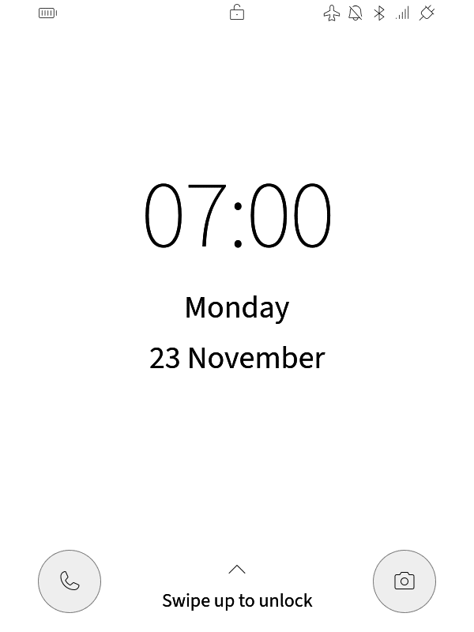
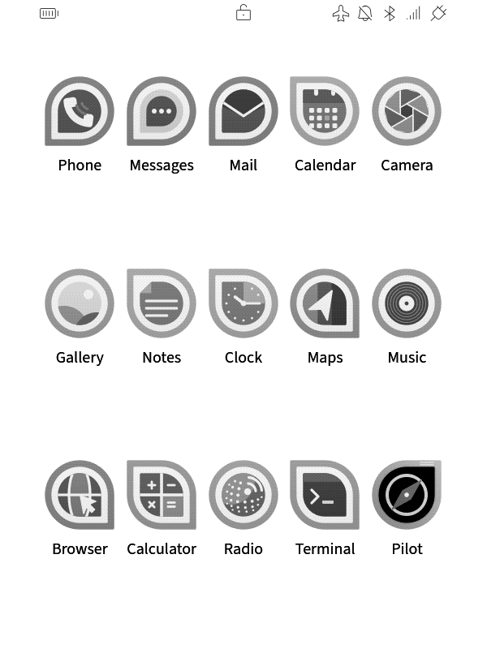
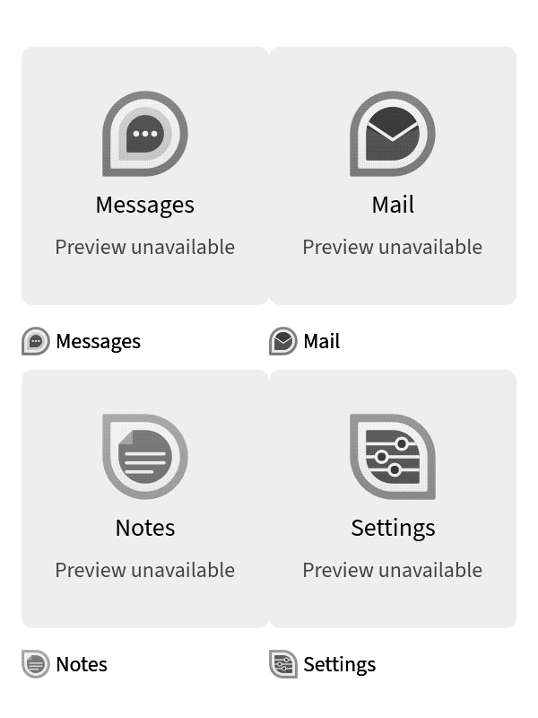
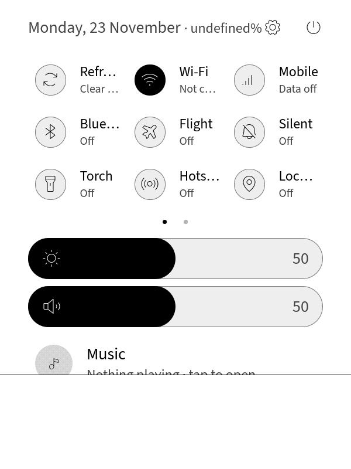
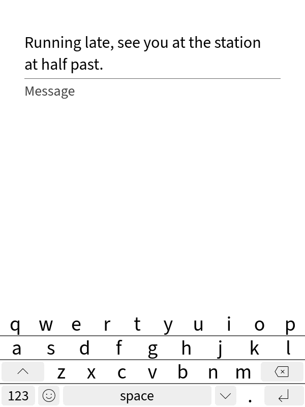
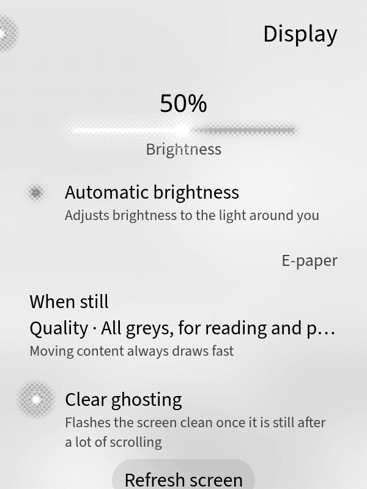

# E-ink mode

Status: first implementation on `feat/eink-mode`, not yet run on a panel.
The first device is the Minimal Phone MP01: a 4.3" 600x800, 16-grey E Ink
panel behind a Pango CPLD that takes 60 Hz DSI video, diffs the frames
itself and exposes two controls, the waveform and a clear. This note
extends [EPAPER_DISPLAY_CLASS.md](EPAPER_DISPLAY_CLASS.md), which sets the
rule that the shell behaves this way because the display is e-paper, never
because the device is an MP01. The research behind it is the MP01
fast-refresh report (`reports/Fast E Ink refresh for MP01.md` in the main
checkout, with its notes); the facts this design depends on are repeated
here.

## The goal, restated for ink

The request was "a smooth 60 fps with no ghosting", reached LTPO-style:
from a 1 Hz floor to 60 Hz quickly, smoothly and with low latency. Ink
cannot do 60 distinct images a second. Black and white pigment settles in
about 100-150 ms and 16-level grey in 450-750 ms, on every electrophoretic
panel shipping in 2026. What carries over from LTPO is the ladder, with
different rungs:

| LTPO | E-paper |
|---|---|
| 1 Hz floor | 0 ink updates: a bistable panel holds its image for free, as long as the frame stays byte-identical |
| Ramp the refresh rate on touch | Switch the waveform on touch: `fast` (two levels, ~120 ms) the moment a finger lands |
| 120 Hz ceiling | ~15-20 settled steps a second in `fast`: content is paced to the waveform, not the 60 Hz link |
| Drop back when idle | Step back to `quality` (16 greys) when still; the switch is silent |
| (no equivalent) | Clean the ghosts with a flash only when asked, or when the screen is still after a lot of `fast` drawing |

So "smooth" here means low latency to the first ink change (an estimated
30-60 ms, first frame not paced) and steady black-and-white motion; "no
ghosting" holds at rest, after the idle clear, and not during motion, on
this or any 2026 panel. These latency figures are engineering estimates
until the camera measurements in "Testing on the MP01".

## Rule zero: a capability

- The display class comes from the device profile:
  `DISPLAY_TECHNOLOGY=epaper` in `/etc/marathon/device-profile.conf`
  (`MARATHON_DISPLAY_TECHNOLOGY` overrides it), exposed to QML as
  `DeviceProfile.displayTechnology`. Everything visual keys off it:
  `MColors.eink` and `MMotion.instant`.
- The refresh controls are probed separately: any I2C device with both
  `refresh_mode` and `full_refresh` attributes (the panel driver's interim
  ABI). `Display.refreshControls` says whether they were found. A panel
  with the class and no controls still gets the rendering policy, and the
  waveform policy simply does not run.
- No `DEVICE_ID`, compatible string or driver name appears in shell code.
  `PANEL_ORIENTATION=kms` (the MP01 scans out 800x600 in a portrait phone)
  is its own key and unrelated.

## Visual language

  

  

Ink on paper: black on white. Marathon's shell is dark everywhere else;
on a reflective panel white is the resting, brightest state, thin Light
text reads best dark on light, and E Ink's own reading UIs are paper. The
brief does not change: flat materials on one plane, BB10 rows, no cards,
Light text and Phosphor Thin icons stay as they are.

- **The panel's 16 greys, exactly.** Every e-ink token is a multiple of
  0x11, so a flat surface never sits between two levels:

  | Token | E-ink | Use |
  |---|---|---|
  | `elev0`, `elev1`, `background` | `#ffffff` | paper |
  | `elev2`, `controlFill`, `bb10Card` | `#eeeeee` | an off control, a key cap |
  | `elev3` / `elev4` / `elev5` | `#dddddd` / `#cccccc` / `#bbbbbb` | rarely; pressed is `#cccccc` |
  | `borderGlass`, `border` | `#777777` | 1 px hairlines around controls that lose their fill |
  | ambience secondary | `#444444` | secondary text |
  | `accentFill`, highlight, error | `#000000` | a switched-on tile, ink |
  | `textOnAccent` | `#ffffff` | glyphs on black |

  `whiteOverlay08/16` darken by one and two levels instead of lightening.
  Ripples and halos are transparent.
- **Colour is gone, not converted.** The accent is ink. Errors use ink
  and their glyph, as the design system already asks for warnings and
  success. Night light and Nightshade's tints are meaningless here and
  stay unchanged; a follow-up can hide them.
- **No gradients, blur or glass.** The ambience background, the lock
  screen and the shade draw plain paper. The wallpaper is not drawn: a
  photo's tones cannot survive anything moving over it in `fast`, and
  every wallpaper change would cost a full grey redraw.
- **Dithering where grey is unavoidable.** Icons, photos and anti-aliased
  edges go through the output shader below: ordered dither between the
  panel's levels, never rounding, so gradients do not band, and exact
  levels pass untouched.
- **Apps follow.** The shell's `AmbienceController` publishes a fixed
  ink-on-paper Keel ambience on e-paper (dark on light, black highlight,
  `#444444` secondary, no wallpaper), and runners relay the ambience to
  apps as they do today. Silica apps therefore turn to paper with no
  change of their own; see "Apps" for what they still lack.

## Motion

None. A fade is a run of partial updates through the greys, and every
partial update leaves ghost residue; a slide is a stream of frames the ink
cannot finish. On e-paper every state change is a cut.

- `MMotion.instant` is true on e-paper. Every role duration, `dur()`,
  `reducedFade` and `micro` are 0, and `MMotion.ms(n)` returns 0 for the
  durations that were written as numbers. Reduce motion is also forced on,
  as before, so travel and scale vanish and attention loops never start
  (`MMotion.gate`).
- Gesture-driven motion (a sheet following the finger, a scroll) still
  follows the finger: that is drawn in `fast`, paced.
- Settle springs after a release use `micro` under Reduce motion, so they
  snap.

## Scrolling

Continuous scrolling in `fast` is the default: the list follows the finger
at the waveform's pace, black and white, and re-settles in grey once still.
Paged scrolling (a list moves a page per swipe, the "page turn" of reading
devices) halves the ink work but breaks every Silica list's flick model.
It belongs to a later per-app hint for readers, not the shell default.
Flings decelerate as usual; the pacing below keeps them to steps the panel
can finish, and the scroll deltas accumulate between steps instead of
being dropped.

## The waveform ladder

`crates/marathon-eink` is the policy, pure and unit-tested;
`crates/marathon-shell-native/src/eink.rs` runs it on its own thread and
writes the panel. Inputs reach it as the compositor receives them, before
any item.

| Moment | Waveform | Why |
|---|---|---|
| Finger or button down | `fast`, at once | The first frame of a drag or a pressed state is drawn fast; no 100-250 ms motion detection first |
| Drag past the slop (12 px), wheel, fling | `fast` | |
| 4 frames in 300 ms without input | `fast` | Video, an app animating, keyboard scrolling |
| Last movement + 350 ms | resting | `MARATHON_EINK_SETTLE_MS`; the report's range is 250-500 ms, set by camera |
| Typing (hardware keys, on-screen keyboard) | `text` for 1.5 s after the last key | Crisp glyphs; a tap on the keyboard while typing stays in `text`, a drag still goes `fast` |
| At rest | `quality` (or `text`, the user's choice) | Full grey |
| Never | `clean` | Entering it double-flashes; stock's resting on it is the "flickers a lot" complaint |

- **Rate limit:** at most one waveform write per 200 ms (stock's rule). A
  change asked for inside the window waits for it; it is not dropped.
- **Clears** are the panel's full flashing refresh (clear, waveform 2, the
  chosen waveform again 100 ms later, all in the driver). They happen only
  at rest, so the driver's restore lands on the resting waveform:
  - explicitly: the Refresh tile, Settings' Refresh screen, the hardware
    refresh key (`KEY_REFRESH`, between the MP01's volume keys) and D-Bus
    `Display1.FullRefresh`; requests within 500 ms are one clear;
  - automatically, on a budget: each frame drawn in `fast` adds one unit of
    ghosting and each whole-screen change (an app switch, unlock, Home, the
    shell's state) adds 30. At 60 units, once the screen has been still for
    1.5 s, the shell clears; at most one automatic clear every 20 s. Off
    with Settings' Clear ghosting.
- **Screen off:** nothing is written, and pending clears are dropped.

What the ladder does not do yet: lock to `fast` while a video or the
viewfinder is fullscreen (the frame-rate rule covers it, with a re-settle
on pause), lengthen the settle and raise the clear rate in the cold (the
CPLD's temperature register), and clear before Doze turns the display off.

### Pacing

While the panel is in `fast`, a frame waits until the previous one is 50 ms
old (`MARATHON_EINK_PACE_MS`, 0 turns it off), in the scene graph's
`beforeFrameBegin` on the render thread. The DSI link stays at 60 Hz, which
the CPLD needs; only content changes are paced. The first frame after a
pause goes at once, so touch-down latency is unchanged. Clients see their
frame callbacks at the same pace and draw no more than the panel shows.

### Output quantization

On e-paper the shell's root item is a layer drawn through
`shell/shaders/eink.frag`: Rec. 601 luma, then the panel's 16 levels with
a 4x4 ordered dither, or two levels while the panel is in `fast`. The
dither is fixed to the panel's pixels, so a still frame stays
byte-identical frame to frame, which is the only partial update this
CPLD understands. The two-level pass is Caster's hybrid on the whole
screen: moving content is binary, and greys come back when it settles.
Ordered dither over error diffusion because diffusion re-dithers
differently every frame and shimmers on scroll. Known limit: the pattern
is anchored to the panel, not the content, so dithered greys shimmer
while they scroll; content-anchored dither needs per-item shaders.

## Cursor and blinking elements

A still screen must not update. On e-paper:

- the text caret does not blink (`QStyleHints::cursorFlashTime` 0 in the
  shell);
- clocks show minutes, as they already do, and change once a minute;
- spinners, pulses and the call rings are attention
  loops and never start (`MMotion.gate`);
- the cell-broadcast banner's pulse is now gated too.

Apps' own carets still blink: see Apps.

## Apps

What apps get today, with no change to them:

- the ink-on-paper ambience (Silica apps follow it; it is published with
  the rest of the ambience);
- the shell's pacing and waveform policy, which see app frames like any
  other content: an app that animates goes `fast` and re-settles.

Follow-ups, in order of value:

1. **The runner tells Keel it is on e-paper.** The runner reads the
   device profile and sets Silica's immediate page transitions (as Reduce
   motion does), the caret flash to 0, and a Keel e-ink style flag. Keel
   then drops the glow on switches, sliders and indicators (visible as
   dithered halos in the Settings mockup) and the page background's
   gradient.
2. **A manifest hint.** `"eink": {"resting": "quality" | "text", "video":
   true}`: a reader asks for `quality`, a chat app for `text`, a video
   player locks `fast` while focused. The shell applies it while the app
   is focused, through the same policy inputs.
3. **Flatpak (GTK).** `gtk-enable-animations=false` and a high-contrast
   light theme through the settings portal the shell already serves.
4. **Android (Deckard).** The three animation scales set to 0 and dark
   theme off while the device is e-paper; Android's own "e-ink" settings do
   not exist upstream.

## Controls

- **Quick settings: Refresh**, the first tile, whenever the panel has
  refresh controls. It closes the shade and clears once the screen is
  still. It is not in the user's tile list: it is the e-paper's own
  control.
- **The hardware refresh key** does the same.
- **Settings > Display > E-paper**, shown only with refresh controls:
  - *When still*: Quality (all greys, for reading and pictures) or Text
    (black and white, crisp and quick);
  - *Clear ghosting*: the automatic clear, on by default;
  - *Refresh screen*.
  Reduce motion is hidden there: there is no motion to reduce.
- **D-Bus** `org.marathonos.Shell.Display1`, for system apps:
  `SetRestingRefreshMode(s)`, `SetAutoClear(b)`, `FullRefresh()`, and
  `refreshControls`, `restingRefreshMode`, `autoClear` in `GetState`.

## The privileged path and the kernel uAPI

The driver's attributes are root-only (`refresh_mode` 0644,
`full_refresh` 0200). The shell is the only writer and it is the policy,
so it writes them itself: `udev/70-marathon-shell.rules` gives them to
group `video` (the session user is in it), mode 0664 and 0220, matched by
the two attributes rather than the driver. Nothing is world-writable, no
daemon sits in the path (rules H1, B12), and a write stays a two-byte I2C
transfer within the frame that asked for it. Other processes go through
the shell: `Display1` behind the `system` permission.

The interim ABI should become KMS state, as
`devices/minimal/mp01/kernel/eink-refresh-api.md` (on
`feat/mp01-integration`) sets out:

1. a connector property `refresh waveform`, an enum named by behaviour
   (`quality`, `clean`, `text`, `fast`), set in the same atomic commit as
   the planes, so the switch to `fast` and the first moved frame land on
   the same scanout. Upstream needs a `drm_panel` hook to describe
   connector properties (the connector belongs to `drm_bridge_connector`)
   and a commit path that hands the panel the new state; host-side EPD
   controllers (Rockchip EBC, i.MX EPDC RFCs) need the same;
2. a one-shot `full refresh` property, cleared by the driver after acting;
3. `FB_DAMAGE_CLIPS`, already upstream, for controllers that can use it;
4. a read-only `panel type` (`lcd`, `oled`, `epd`), so compositors need
   no profile key;
5. the CPLD's temperature through hwmon, for the cold tuning above.

The shell would then put the waveform in its commit instead of writing
sysfs; `marathon-eink` does not change. Whatever the uAPI, the kernel must
never carry the vendor's reflash path (`update_firmware()`, reflash on a
low version, `eink_cpld_registers` commands 9 or 16): a bad CPLD flash is
assumed permanent.

## Implementation map

| Piece | Where |
|---|---|
| Policy (waveforms, rate limit, typing, frames as motion, clear budget, pacing) | `crates/marathon-eink` |
| Policy thread, panel probe and writes, input and frame entry points | `crates/marathon-shell-native/src/eink.rs` |
| Display properties, settings, D-Bus | `crates/marathon-shell-native/src/display.rs`, `shell/main.cpp` |
| Input hook (touch, drag, wheel, keys, refresh key) | `shell/src/services/einkinput.h` |
| On-screen keyboard typing | `shell/src/services/inputcontext.cpp` |
| Pacing and frame hooks | `shell/main.cpp` (`beforeFrameBegin`, `frameSwapped`) |
| Palette | `shell/qml/theme/MColors.qml`, `shell/qml/core/AmbienceController.qml` |
| Motion | `shell/qml/theme/MMotion.qml`, durations through `MMotion.ms` |
| Output quantization | `shell/shaders/eink.frag`, `MarathonShell.qml` |
| Refresh tile, Settings section | `MarathonQuickSettings.qml`, `apps/settings/pages/DisplayPage.qml`, `crates/marathon-app-native/src/display.rs` |
| Access | `udev/70-marathon-shell.rules` |
| Mockups | `docs/design/eink/` (`render-mockups.sh`, `quantize.py`) |

The mockups are the shell's own QML components rendered offscreen at
600x800 and `MARATHON_FORCE_DPI=160` with the test stubs. The offscreen
renderer has no GPU for the output shader, so `quantize.py` applies the
same arithmetic to the captures; `home-fast.png` is the two-level pass.
`compare-lcd.png` sets them against today's look. Stub artefacts: the
status bar's battery reads "undefined%" and Wi-Fi shows on.

## Testing on the MP01

Functional, in order:

1. `cat /sys/bus/i2c/devices/*/refresh_mode` and `ls -l` on both
   attributes after the udev rule: group `video`, 0664/0220.
2. The shell log has `eink: refresh controls at /sys/bus/i2c/devices/7-004b`.
3. Touch and drag on the home grid: `refresh_mode` reads `[fast]` during the
   drag and `[quality]` ~350 ms after release. Typing in a text field:
   `[text]`, back to `[quality]` 1.5 s after the last key.
4. Refresh tile, Settings' Refresh screen and the refresh key each flash
   once, after the screen is still. Scroll a long list for 3 s and stop:
   one automatic flash ~1.5 s later, none on a short scroll.
5. The palette: paper everywhere in the shell; Settings in paper; nothing
   on screen updates while idle (no caret blink, no spinner).
6. Kill switches if something misbehaves: `MARATHON_EINK_PACE_MS=0` (no
   pacing), `MARATHON_DISPLAY_TECHNOLOGY=lcd` (everything off).

Measurements that set the numbers (none writes flash): film the panel at
240 fps or more with an evdev-timed marker, toggling a black-and-white
block and a 16-grey ramp in each mode. That gives each waveform's length
(the pacing period), touch-to-first-ink and settle times (the settle
delay), the flash matrix including the disputed fast-to-quality case, and
the ghosting per screen of scroll (the clear budget). Repeat cold.
